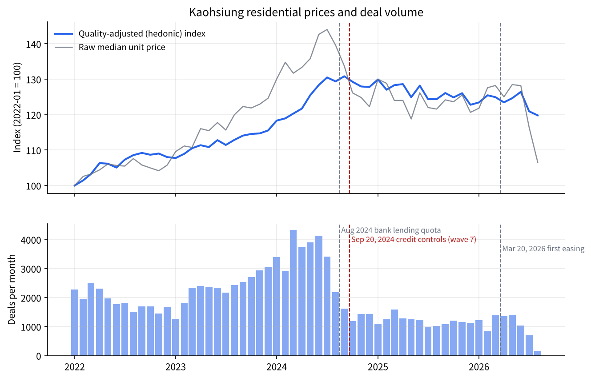
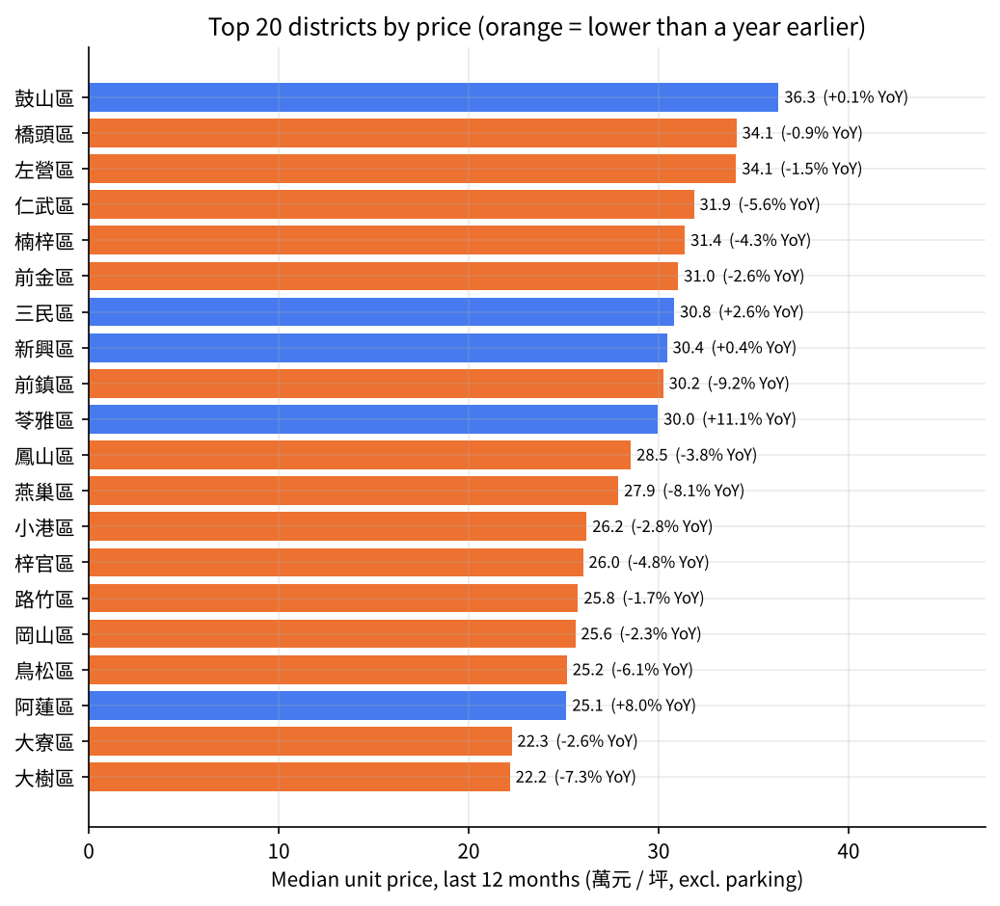
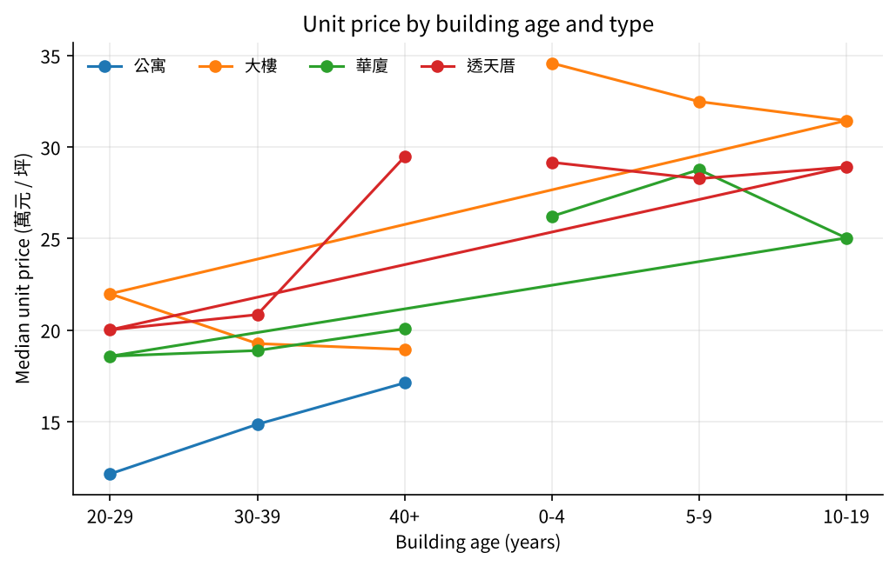
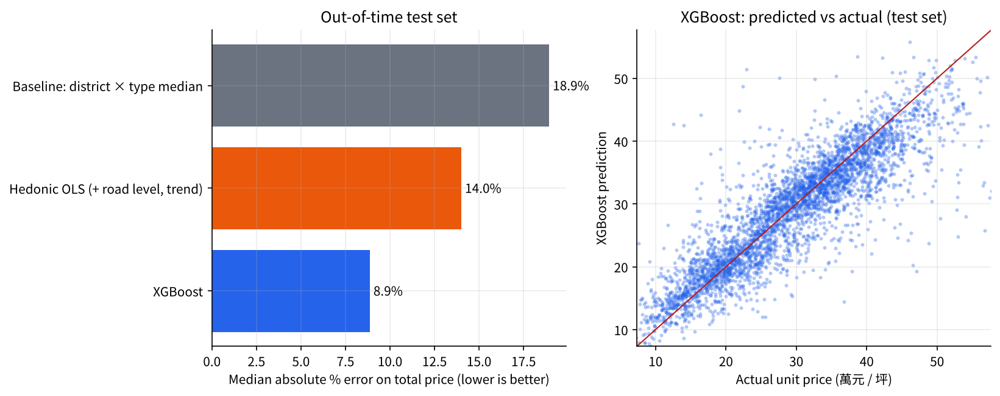
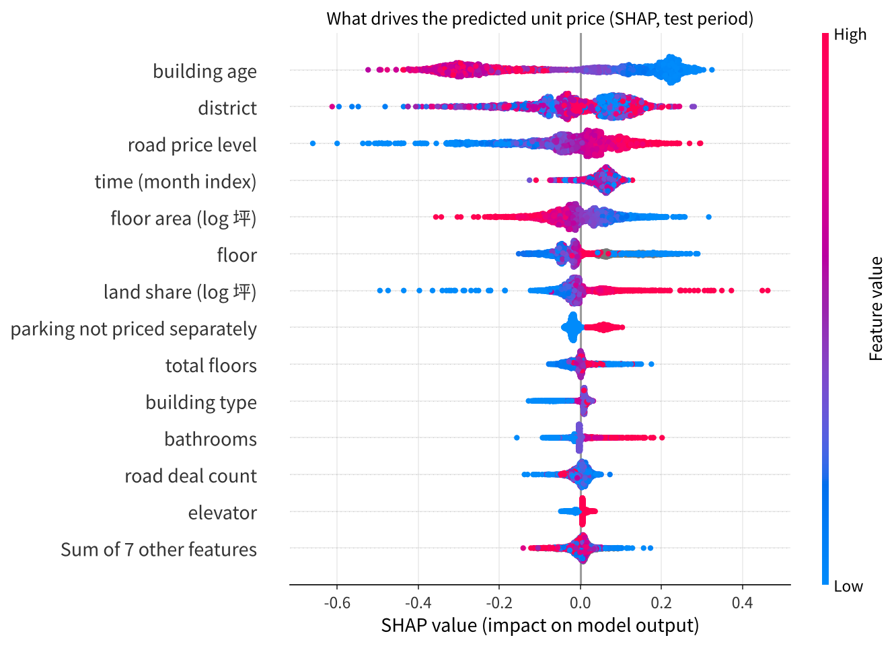
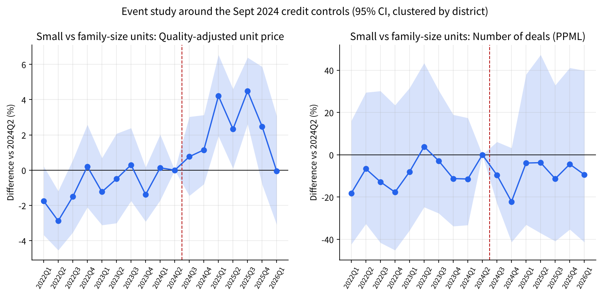
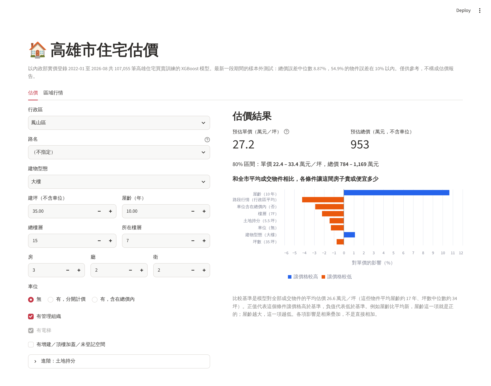

# Kaohsiung Housing Prices: Analysis and Valuation Model

[中文版](README.md) · **[Live valuation app](https://kaohsiung-housing-price-gkrgupx6fvvypxjv8cxobe.streamlit.app/)** · [Walkthrough notebook](notebooks/walkthrough.ipynb)

**Question.** How accurately can Kaohsiung homes be valued from public transaction records? And did Taiwan's September 2024 mortgage credit controls hit investor-type small units harder than family homes?
**Approach.** Clean 199k Kaohsiung sale records (19 quarterly releases, 2022-01 to 2026-08) from the Ministry of the Interior's actual-price registry; analyse the market in SQL; build a quality-adjusted price index with a hedonic regression; compare XGBoost with econometric models on an out-of-time test set; and evaluate the credit controls with an event study / difference-in-differences.
**Results.** On 2026 deals the XGBoost model has a **median absolute error of 8.9%** on total price (hedonic OLS 14.0%, baseline 18.9%); 80% of homes are within ±20%. Quality-adjusted prices rose **31%** from 2022-01 to the September 2024 peak and have edged down since. There is **no robust differential effect** of the credit controls on small units: the plain DiD is +3.2%, but small units were already catching up before the controls; after removing that trend the estimate is +1.7% (p ≈ 0.10), and deal volumes show no significant difference.



---

## Contents

> For a step-by-step version of the whole analysis, see the [walkthrough notebook](notebooks/walkthrough.ipynb) (executed, with all outputs).

1. [Data and cleaning](#1-data-and-cleaning)
2. [SQL analysis](#2-sql-analysis)
3. [Quality-adjusted price index](#3-quality-adjusted-price-index)
4. [Valuation model](#4-valuation-model)
5. [Policy study: the September 2024 credit controls](#5-policy-study-the-september-2024-credit-controls)
6. [Valuation web app](#6-valuation-web-app)
7. [Reproduce](#7-reproduce)
8. [Project layout](#8-project-layout)

---

## 1. Data and cleaning

Source: quarterly open-data releases (ROC 111S1–115S3) of the MOI Real Estate Actual Price Registration service, Kaohsiung existing-home sales (`E_LVR_LAND_A.CSV`). `scripts/download_data.py` downloads them; `src/khp/ingest.py` reads straight from the zip files, checks the zip signature, skips the English second header row, de-duplicates on the official serial number, and skips and logs malformed rows (`reports/ingest_log.csv`).

Every cleaning step is logged (`reports/cleaning_log.csv`):

| Step | Rows left | Removed |
|---|---:|---:|
| Raw Kaohsiung records (de-duplicated) | 199,457 | |
| Keep sales that include a building (drop land-only / parking-only) | 160,929 | 38,528 |
| Keep residential types (high-rise, mid-rise, walk-up, townhouse, studio) | 160,882 | 47 |
| Keep single-building deals | 159,665 | 1,217 |
| Trade date on/after 2022-01-01 | 128,684 | 30,981 |
| Drop non-arm's-length deals flagged in the notes (related parties, defects, foreclosures, partial shares, …) | 113,248 | 15,436 |
| Drop commercial / industrial main use | 110,383 | 2,865 |
| Area 5–300 ping, price > NT$300k | 110,098 | 285 |
| Drop outliers (robust z of log unit price > 3.5 within district × type) | **108,063** | 2,035 |

Key decisions:

- **Unit price** = (total price − separately priced parking) ÷ (building area − parking area), in NT$10k per ping (3.3 m²). When parking is included but not priced separately (46% of deals with parking) the deal is kept and flagged with `parking_unpriced`.
- **Building additions are not "special" deals.** Notes mentioning additions, rooftop extensions or unregistered space originally caused the deal to be dropped. Checking the real data showed this removed 17,039 ordinary deals, including **about half of all townhouse sales**. They are now kept and flagged with `has_addition` (about +8% in the hedonic model).
- **Data-quality checks:** road names parsed for 98.9% of (partly masked) addresses; building age missing for 0.9%; median unit price 28.6 (NT$10k/ping), 86% between 15 and 45.
- Four mountain districts with 7 deals in four years are left out of modelling (too few to estimate a district effect).

## 2. SQL analysis

The clean data is loaded into SQLite (`src/khp/database.py`); six queries in `sql/` write their results to `reports/sql/`:

| Query | What it shows | Techniques |
|---|---|---|
| `10_monthly_market.sql` | Monthly volume and median unit price | CTE, `ROW_NUMBER()` median |
| `11_district_summary.sql` | Each district: last 12 months vs the 12 before | Multiple CTEs, `JOIN`, `CASE` aggregation |
| `12_district_quarterly_yoy.sql` | Year-over-year change by district × quarter | `LAG(…, 4)` |
| `13_top_roads.sql` | Top-3 most expensive roads per district | `DENSE_RANK()` |
| `14_age_premium.sql` | Median unit price by building age and type | `CASE` buckets, window-function median |
| `15_segment_monthly.sql` | Small vs family-size units per month | `CASE` segments, window-function median |



## 3. Quality-adjusted price index

A raw median moves with the mix of homes sold; in early 2024, for instance, a wave of newly completed buildings pushed it up. The hedonic regression puts log unit price on area, age, type, floor, layout, parking, additions, district and **month fixed effects** (errors clustered by district, R² = 0.69). The month effects trace the quality-adjusted price level.

- The quality-adjusted index rose **31%** from 2022-01 to its September 2024 peak; the raw median was briefly 43% above its 2022-01 level in June 2024, the excess being mostly a composition effect from new buildings.
- After September 2024 the index was broadly flat and by end-2025 sat about 6% below the peak. Monthly deals fell from 3,000–4,000 in early 2024 to about 1,200.
- Other coefficients: about −2.9% per year of building age (with a quadratic term); high-rises about +45% over walk-ups; additions about +8%.

> Note: deals are registered only after the title transfer, so the last one or two months (2026-07 and 08) are incomplete; treat their index values with caution.



## 4. Valuation model

**Validation is out-of-time**, as the model would be used in practice: past deals predict future ones.

| Split | Period | Rows | Used for |
|---|---|---:|---|
| Train | 2022-01 – 2025-06 | 92,377 | Fitting |
| Validation | 2025-07 – 2025-12 | 6,576 | Tuning, early stopping |
| Test | 2026-01 – 2026-08 | 8,102 | Scored once at the end |

Features: area, age, floor, layout, parking, additions, district, time, and a **road price level**: the smoothed (m-estimate, m = 20) mean log unit price of each (district, road), computed out-of-fold (5 folds) on the training data so a deal never sees its own price (no target leakage).

Test-period results (errors measured on total price):

| Model | MdAPE | MAPE | Within ±10% | Within ±20% | R² (log unit price) |
|---|---:|---:|---:|---:|---:|
| Baseline: district × type median, last 12 months | 18.9% | 30.1% | 29.7% | 52.0% | 0.31 |
| Hedonic OLS (+ road level, time trend) | 14.0% | 21.1% | 37.9% | 64.4% | 0.63 |
| **XGBoost** | **8.9%** | **13.3%** | **54.9%** | **80.3%** | **0.80** |



SHAP values show building age matters most, followed by district, road price level and time:



## 5. Policy study: the September 2024 credit controls

**Background.** In mid-August 2024 the central bank asked banks to cap property lending. On **2024-09-20 the 7th round of selective credit controls** took effect: the loan-to-value cap for second homes fell to 50% nationwide, owners buying again lost interest-only grace periods, and third-plus homes and corporate buyers were capped at 30%. On 2026-03-20 the second-home cap was eased to 60%.

**Design.** The controls target second-home buyers and investors, who disproportionately buy small units. So **small units** (studios or 1–2 bedrooms, more exposed) are compared with **family units** (3+ bedrooms, mostly owner-occupiers; first-time buyers and the subsidised youth mortgage were exempt) before and after the controls. Sample: apartments only, 2022-01-01 to 2026-03-19 (the day before the first easing), 77,353 deals.

- Price: log unit price with hedonic controls, district and month fixed effects, and small × quarter dummies (reference 2024Q2).
- Volume: deal counts by district × segment × quarter, Poisson pseudo-maximum likelihood (PPML) with district × quarter and district × segment fixed effects.



**Results:**

| Test | Estimate | Inference |
|---|---|---|
| Price DiD (small × post) | +3.2% (95% CI 2.0 to 4.4%) | Cluster SE p < 0.001; wild cluster bootstrap p = 0.007 |
| Price pre-trend (9 pre-period dummies jointly) | F(9, 29) = 5.86 | **p ≈ 0.0001: parallel trends rejected** |
| Price DiD with a small-unit linear trend | +1.7% (95% CI −0.3 to 3.7%) | **p ≈ 0.10, not significant** |
| Volume DiD (PPML) | −1.8% (95% CI −17 to 16%) | p = 0.83, not significant |
| Volume pre-trend | F(9, 21) = 1.95 | p ≈ 0.10 |

**Interpretation.** The plain DiD suggests small units gained 3.2% relative to family units after the controls. But the event study shows small units were about 2–3% behind in early 2022 and had been catching up well before the controls, so **parallel trends fails**. Net of that pre-existing trend the effect falls to 1.7% and is not significant. Conclusion: **no robust evidence that the credit controls had a differential effect on small-unit prices or volumes.**

**Inference with few clusters.** There are only 30 districts (22 in the volume panel), and cluster-robust Wald tests over-reject with few clusters. So the study also reports:

- pre-trend tests with an F distribution and G − 1 denominator degrees of freedom;
- a wild cluster restricted bootstrap p-value (Webb six-point weights, 999 replications) for the price DiD (Cameron, Gelbach & Miller 2008; Roodman et al. 2019), implemented in `policy.wild_cluster_bootstrap` with unit tests.

**Limitations.**

- The design identifies a *differential* effect only. Shocks common to both groups (the bank lending caps from August 2024, the general market cool-down) are absorbed by the fixed effects, so the effect on the market as a whole is not identified.
- Bedroom count is a proxy for buyer type; the data does not say whether a buyer already owns a home.
- The linear-trend adjustment is itself an assumption; if the pre-existing trend is non-linear, the estimate can still be biased.

## 6. Valuation web app

**Live: https://kaohsiung-housing-price-gkrgupx6fvvypxjv8cxobe.streamlit.app/** (Streamlit Community Cloud; the app sleeps when idle, so the first load can take a few tens of seconds)

`app/streamlit_app.py`: choose district, road, type, area, age, floor, layout, parking and additions to get a valuation, an 80% prediction interval (from the 10th/90th percentiles of test-period log residuals) and a SHAP breakdown of what drives the price. A second tab shows local market statistics.



```bash
streamlit run app/streamlit_app.py
```

## 7. Reproduce

```bash
pip install -r requirements.txt
python scripts/download_data.py      # quarterly files 111S1–115S3 into data/raw/ (~285 MB)
python run_pipeline.py               # ingest → clean → sql → model → policy → figures (~2 min)
python run_pipeline.py --from model  # re-run from a later step
python -m pytest                     # unit tests
```

If the download URL stops working, download the CSV season files by hand from the [open-data page](https://plvr.land.moi.gov.tw/DownloadOpenData) (非本期下載) into `data/raw/`.

## 8. Project layout

```
scripts/download_data.py   download the quarterly files
run_pipeline.py            run every step
src/khp/
  config.py                paths, constants, keywords, policy dates
  ingest.py                read Kaohsiung files from the zips
  clean.py                 parse ROC dates, Chinese floor numbers, road names; filters, outliers, cleaning log
  database.py              load SQLite, run sql/
  features.py              features, out-of-fold road target encoding
  modeling.py              hedonic model and price index; baseline / OLS / XGBoost comparison
  policy.py                event study, DiD, wild cluster bootstrap
  plots.py                 report figures
sql/                       schema and six analysis queries
app/streamlit_app.py       valuation web app
tests/                     unit tests
models/, reports/          trained model, tables and figures
```

---

Data: MOI Real Estate Actual Price Registration service, used under the [Open Government Data License, version 1.0](https://data.gov.tw/license). Valuations are indicative only and are not a formal appraisal.
