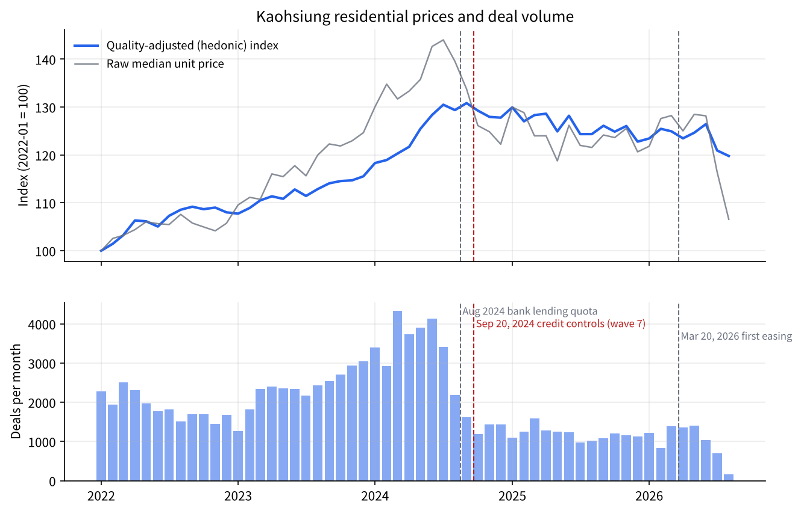
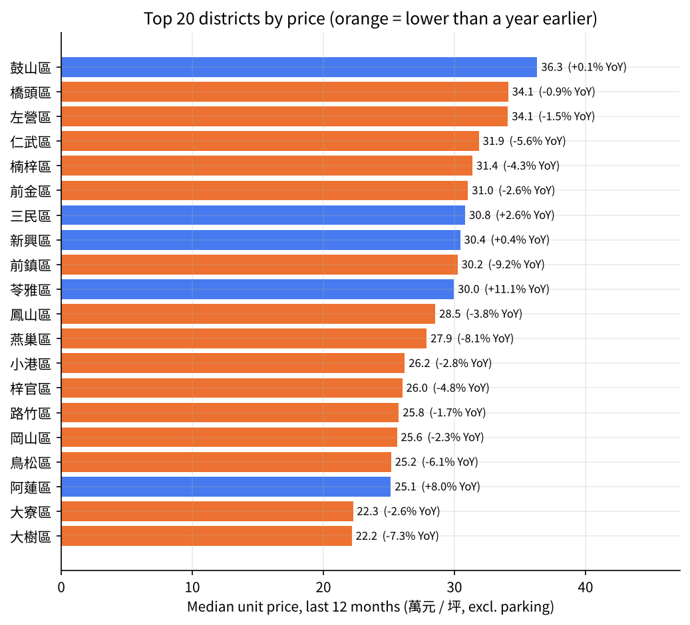
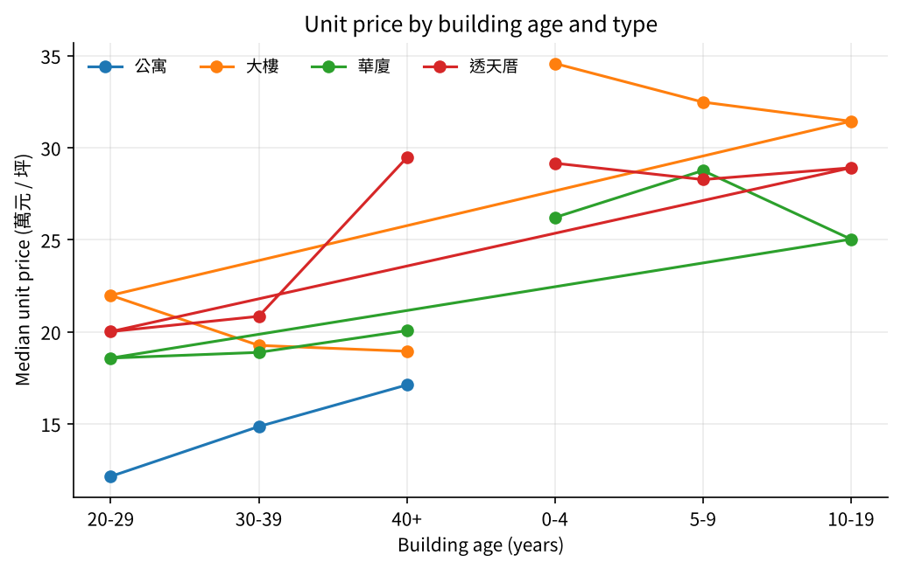
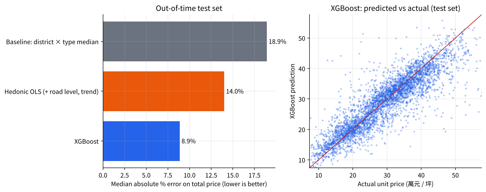
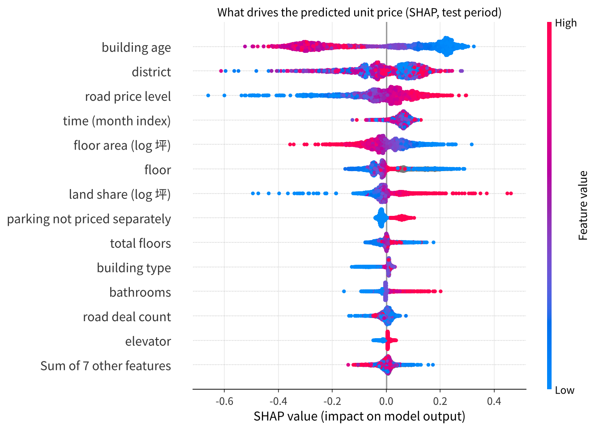
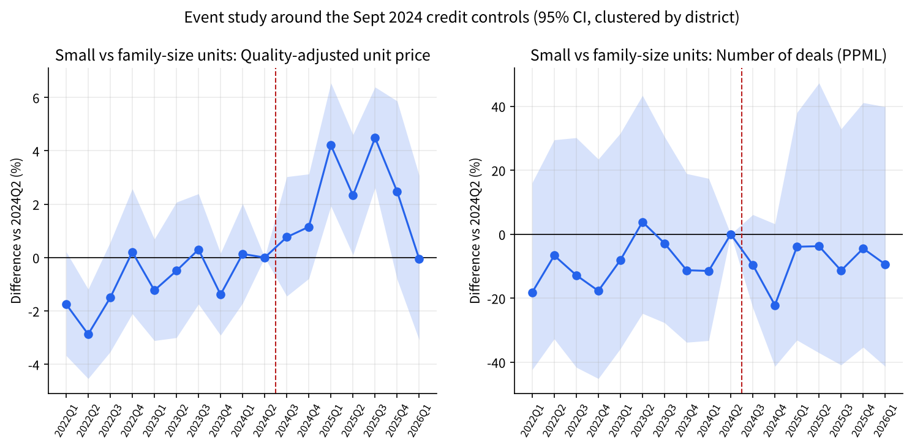
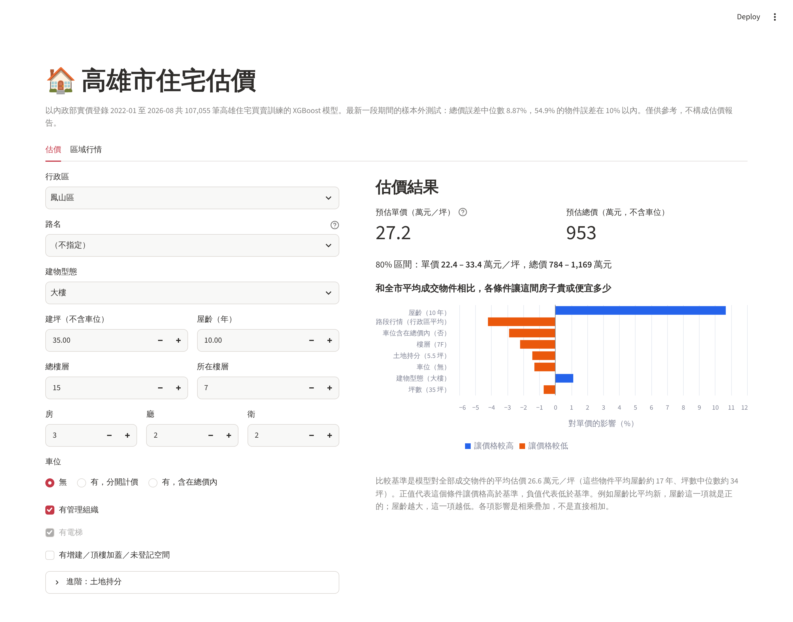

# 高雄房價分析與估價模型

[English version](README.en.md) · **[線上估價網頁](https://kaohsiung-housing-price.streamlit.app/)** · **[估價 API 文件](https://kaohsiung-housing-price.onrender.com/docs)** · [導覽 notebook](notebooks/walkthrough.ipynb)

用內政部實價登錄的公開資料，分析高雄 2022–2026 年的房價，建立一個可以線上使用的估價模型，並評估 2024 年 9 月央行信用管制的影響。

### 想回答的兩個問題

1. 只用公開的實價登錄資料，高雄住宅能估得多準？
2. 央行第七波信用管制（2024-09-20 生效）有沒有讓投資客常買的小坪數住宅，受到比家庭型住宅更大的衝擊？

### 主要結果

| | 結果 |
|---|---|
| **估價準確度** | XGBoost 在 2026 年的新交易上，總價誤差中位數 **8.9%**，80% 的物件誤差在 ±20% 以內（特徵價格模型 14.0%、基準模型 18.9%） |
| **房價走勢** | 品質調整後，房價從 2022-01 到 2024-09 高點上漲 **31%**，之後持平微跌 |
| **信用管制** | **沒有穩健證據**顯示小坪數受到較大衝擊。表面上小坪數相對漲了 3.2%，但大部分來自管制前就存在的趨勢；扣掉後只剩 +1.7%，不顯著。交易量也沒有差異 |

### 做了什麼

- **資料工程**：自動下載 19 季資料，清理 19.9 萬筆紀錄，每一步刪除的筆數都有紀錄
- **SQL**：在 SQLite 做行情、年增率、路段排名分析（CTE、視窗函數）
- **計量經濟**：特徵價格模型建立品質調整房價指數；事件研究／DiD，搭配 wild cluster bootstrap
- **機器學習**：XGBoost，用時間切分做樣本外驗證，SHAP 解釋
- **成品**：[線上估價網頁](https://kaohsiung-housing-price.streamlit.app/)、[估價 API](#7-估價-apifastapi--docker)（FastAPI、Docker、GitHub Actions CI）、[導覽 notebook](notebooks/walkthrough.ipynb)



---

## 目錄

> 想一步步看完整分析過程：[導覽 notebook](notebooks/walkthrough.ipynb)（已執行，含所有輸出）。

1. [資料與清理](#1-資料與清理)
2. [SQL 分析](#2-sql-分析)
3. [品質調整房價指數](#3-品質調整房價指數)
4. [估價模型](#4-估價模型)
5. [政策分析：2024 年 9 月信用管制](#5-政策分析2024-年-9-月信用管制)
6. [估價網頁](#6-估價網頁)
7. [估價 API（FastAPI + Docker）](#7-估價-apifastapi--docker)
8. [如何重現](#8-如何重現)
9. [專案結構](#9-專案結構)

---

## 1. 資料與清理

資料來源是內政部不動產交易實價查詢服務網的季檔（111S1–115S3），只用高雄市成屋買賣（`E_LVR_LAND_A.CSV`）。`scripts/download_data.py` 會自動下載，`src/khp/ingest.py` 直接從 zip 讀檔，會檢查 zip 檔頭、略過英文第二列表頭、依官方編號去重，欄位格式不對的列會跳過並記錄在 `reports/ingest_log.csv`。

每一步清理刪掉多少筆都會記錄（`reports/cleaning_log.csv`）：

| 步驟 | 剩下筆數 | 刪除 |
|---|---:|---:|
| 高雄原始紀錄（去重後） | 199,457 | |
| 只留含建物的交易（排除純土地、純車位） | 160,929 | 38,528 |
| 只留住宅型態（大樓／華廈／公寓／透天厝／套房） | 160,882 | 47 |
| 只留單一建物的交易 | 159,665 | 1,217 |
| 交易日期 2022-01-01 以後 | 128,684 | 30,981 |
| 排除備註標記的特殊交易（親友、瑕疵、凶宅、法拍、持分……） | 113,248 | 15,436 |
| 排除主要用途為商業／工業 | 110,383 | 2,865 |
| 面積 5–300 坪、價格 > 30 萬 | 110,098 | 285 |
| 排除離群值（行政區 × 型態內 log 單價 robust z > 3.5） | **108,063** | 2,035 |

幾個重要決定：

- **單價定義**：（總價 − 分開計價的車位價）÷（建物面積 − 車位面積），單位萬元／坪。有車位但沒有分開計價的交易（佔有車位交易的 46%）不刪除，標記 `parking_unpriced` 當作特徵。
- **增建不算特殊交易**：備註寫「增建、頂樓加蓋、未登記」的交易原本會被當成特殊交易刪掉，但實際檢查發現這會刪掉 17,039 筆正常交易，包含**約一半的透天厝**。這些都是正常的市場交易，所以改成保留，並加上 `has_addition` 特徵（特徵價格模型中係數約 +8%）。
- **資料品質檢查**：路名解析成功率 98.9%（地址有遮蔽）、屋齡缺值 0.9%、單價中位數 28.6 萬／坪，86% 落在 15–45 萬之間。
- 那瑪夏、桃源、田寮、茂林四個山區行政區四年只有 7 筆交易，無法估計行政區效果，不納入模型。

## 2. SQL 分析

清理後資料寫入 SQLite（`src/khp/database.py`），`sql/` 裡有 6 支分析查詢，結果存在 `reports/sql/`：

| 查詢 | 內容 | 用到的技巧 |
|---|---|---|
| `10_monthly_market.sql` | 每月交易量與單價中位數 | CTE、`ROW_NUMBER()` 算中位數 |
| `11_district_summary.sql` | 各行政區近 12 個月與前 12 個月行情比較 | 多個 CTE、`JOIN`、`CASE` 條件彙總 |
| `12_district_quarterly_yoy.sql` | 行政區 × 季的年增率 | `LAG(…, 4)` |
| `13_top_roads.sql` | 各行政區單價前三高的路段 | `DENSE_RANK()` |
| `14_age_premium.sql` | 各型態不同屋齡的單價中位數 | `CASE` 分組、視窗函數中位數 |
| `15_segment_monthly.sql` | 小坪數與家庭型住宅的月交易量與單價 | `CASE` 分群、視窗函數中位數 |



## 3. 品質調整房價指數

單純看單價中位數會受到「這個月賣的是什麼房子」影響，例如 2024 年上半年大量新成屋交屋，中位數就被拉高。特徵價格模型用 log 單價對面積、屋齡、型態、樓層、格局、車位、增建、行政區和**月份固定效果**回歸（標準誤以行政區為 cluster，R² = 0.69），月份固定效果就是控制品質後的價格變化。

- 品質調整指數從 2022-01 到 2024-09 高點上漲 **31%**；單價中位數在 2024-06 一度比 2022-01 高出 43%，比指數多出的部分主要是新成屋比例變高造成的組成效果。
- 2024 年 9 月以後指數大致持平，2025 年底比高點低約 6%。交易量從 2024 年上半年每月 3,000–4,000 筆降到約 1,200 筆。
- 其他係數：屋齡每多 1 年單價約 −2.9%（有二次項）；大樓比公寓高約 45%；有增建約 +8%。

> 注意：實價登錄在產權移轉後才申報，最後一兩個月（2026-07、08）的交易還沒登錄完整，這兩個月的指數僅供參考。



## 4. 估價模型

**驗證方式採時間切分**，模擬真實使用情境：用過去的交易預測未來的交易。

| 資料集 | 期間 | 筆數 | 用途 |
|---|---|---:|---|
| 訓練 | 2022-01 – 2025-06 | 92,377 | 訓練 |
| 驗證 | 2025-07 – 2025-12 | 6,576 | 調參數、early stopping |
| 測試 | 2026-01 – 2026-08 | 8,102 | 只在最後評估一次 |

特徵包含面積、屋齡、樓層、格局、車位、增建、行政區、交易時間，以及**路段行情**：(行政區, 路名) 的 log 單價平滑平均（m-estimate，m=20），訓練資料用 5-fold out-of-fold 計算，避免模型從這個特徵看到自己的價格（target leakage）。

測試期結果（誤差是以總價計算）：

| 模型 | MdAPE | MAPE | 誤差 ±10% 內 | 誤差 ±20% 內 | R²（log 單價） |
|---|---:|---:|---:|---:|---:|
| 基準：行政區 × 型態近 12 月中位數 | 18.9% | 30.1% | 29.7% | 52.0% | 0.31 |
| 特徵價格 OLS（＋路段行情、時間趨勢） | 14.0% | 21.1% | 37.9% | 64.4% | 0.63 |
| **XGBoost** | **8.9%** | **13.3%** | **54.9%** | **80.3%** | **0.80** |



SHAP 顯示影響最大的是屋齡，其次是行政區、路段行情和交易時間：



## 5. 政策分析：2024 年 9 月信用管制

**背景**：2024 年 8 月中旬央行要求銀行控管不動產貸款總量；**2024-09-20 第七波選擇性信用管制生效**（第 2 戶貸款成數上限降為 5 成並擴及全國、名下有房者購屋無寬限期、第 3 戶以上與法人降為 3 成）。2026-03-20 第 2 戶成數放寬為 6 成。

**設計**：管制主要影響第二屋和投資客，這類買家比較常買小坪數。所以比較**小坪數**（套房或 1–2 房，受影響較大）和**家庭型**（3 房以上，自住為主，首購與新青安不受限）在管制前後的差異。只用大樓／華廈／公寓／套房，期間 2022-01-01 到 2026-03-19（第一次放寬前），共 77,353 筆。

- 價格：log 單價，控制特徵價格變數、行政區固定效果、月份固定效果，加上「小坪數 × 各季」虛擬變數（基期 2024Q2）。
- 交易量：行政區 × 區隔 × 季的筆數，用 PPML（Poisson）並放入行政區×季、行政區×區隔固定效果。



**結果**：

| 檢定 | 估計值 | 推論 |
|---|---|---|
| 價格 DiD（小坪數 × 管制後） | +3.2%（95% CI 2.0–4.4%） | cluster SE p<0.001；wild cluster bootstrap p=0.007 |
| 價格 pre-trend（管制前 9 季聯合檢定） | F(9, 29) = 5.86 | **p≈0.0001，平行趨勢不成立** |
| 價格 DiD，加入小坪數線性趨勢 | +1.7%（95% CI −0.3–3.7%） | **p≈0.10，不顯著** |
| 交易量 DiD（PPML） | −1.8%（95% CI −17–16%） | p=0.83，不顯著 |
| 交易量 pre-trend | F(9, 21) = 1.95 | p≈0.10 |

**解讀**：單純 DiD 看起來小坪數價格在管制後相對上漲 3.2%，但事件研究圖顯示，小坪數在 2022 年上半年落後家庭型約 2–3%，管制前就一路追上來，**平行趨勢假設不成立**。扣除這個既有趨勢後效果只剩 1.7% 且不顯著。所以結論是：**沒有穩健證據顯示信用管制對小坪數住宅的價格或交易量有差異效果。**

**推論的穩健性**：只有 30 個行政區（交易量模型 22 個），cluster-robust 的 Wald 檢定在 cluster 少時容易過度拒絕，所以另外報告：

- pre-trend 檢定用 F 分布，分母自由度 G − 1；
- 價格 DiD 用 wild cluster restricted bootstrap（Webb 六點權重，999 次）重算 p 值（Cameron, Gelbach & Miller 2008；Roodman et al. 2019），實作在 `policy.wild_cluster_bootstrap`，有單元測試。

**限制**：

- 這個設計只能估「差異效果」。兩組同時受到的衝擊（例如 2024 年 8 月起的銀行房貸總量控管、整體市場降溫）都被固定效果吸收，無法看出管制對整體市場的影響。
- 用房數分群是買家類型的代理變數，資料裡沒有買方是否為第二屋的資訊。
- 小坪數在管制前就有相對上漲的趨勢，線性趨勢調整只是一種假設；趨勢若是非線性，估計仍可能有偏誤。

## 6. 估價網頁

**線上版：https://kaohsiung-housing-price.streamlit.app/**（Streamlit Community Cloud；一段時間沒人使用會休眠，第一次開啟需等幾十秒喚醒）

`app/streamlit_app.py`：選行政區、路名、型態、坪數、屋齡、樓層、格局、車位、是否有增建，就會給出估價、80% 預測區間（用測試期 log 殘差的 10%／90% 分位數），以及各因素對價格的影響（SHAP）。另有「區域行情」分頁。



```bash
streamlit run app/streamlit_app.py
```

## 7. 估價 API（FastAPI + Docker）

把同一個模型包成 REST API，讓其他系統（或面試官的 curl）可以直接呼叫，並附互動式 API 文件。

**線上版：https://kaohsiung-housing-price.onrender.com/docs**（Render 免費方案，Docker 部署，main 分支有新 commit 會自動重新部署；閒置 15 分鐘會休眠，第一次請求需等 30–60 秒喚醒）

| | |
|---|---|
| **文件** | `/docs`（Swagger UI，可直接在瀏覽器上送出請求）、`/openapi.json` |
| **主要端點** | `POST /predict` 單筆估價（含 80% 區間與 SHAP 影響因素）、`POST /predict/batch` 一次最多 100 筆、`GET /model/info` 訓練期間與測試集準確度、`GET /districts`、`GET /districts/{行政區}/roads`、`GET /health` |
| **輸入驗證** | Pydantic：行政區／型態必須在模型認得的清單內，坪數、屋齡、樓層有範圍限制，非透天厝一定要填樓層且不得高於總樓層，錯誤回 422 |
| **容器** | `Dockerfile`（python:3.13-slim，模型檔包進映像、非 root 執行、`/health` healthcheck，監聽 `$PORT`） |
| **CI** | GitHub Actions：Python 3.12／3.13 跑 pytest，另一個 job 建映像、啟動容器、等 `/health`、打一次 `/predict` 驗證回傳值合理 |

serving 的程式在 `src/khp/predictor.py`，特徵組法和訓練時（`src/khp/features.py`）、Streamlit app 完全一致：路段行情查 `models/road_encoding.csv`，沒見過的路名退回行政區平均；`t` 固定在訓練資料最後一個月，也就是「以目前價格水準估這間房子」。

```bash
# 本機
pip install -r api/requirements.txt
uvicorn api.main:app --reload          # http://127.0.0.1:8000/docs

# 容器
docker build -t khp-api .
docker run --rm -p 8000:8000 khp-api
```

```bash
curl -X POST https://kaohsiung-housing-price.onrender.com/predict -H 'Content-Type: application/json' -d '{
  "district": "鳳山區", "btype": "大樓", "area_ping": 35, "age_years": 10,
  "total_floors": 15, "floor": 7, "road": "中山東路", "parking": "separate"}'
```

```json
{
  "unit_price_10k_per_ping": 26.79,
  "total_price_10k": 937.7,
  "interval_80": {"unit_low": 22.04, "unit_high": 32.86, "total_low": 771.3, "total_high": 1150.1},
  "road_used": "中山東路",
  "baseline_unit_price": 26.64,
  "top_factors": [{"feature": "age_years", "effect_pct": 9.94}, {"feature": "district", "effect_pct": -4.38}]
}
```

價格單位為萬元、面積為坪；`top_factors` 是 SHAP 值，表示該條件讓單價比「全市平均成交物件」高或低多少百分比。

## 8. 如何重現

```bash
pip install -r requirements.txt
python scripts/download_data.py      # 下載 111S1–115S3 季檔到 data/raw/（約 285 MB）
python run_pipeline.py               # ingest → clean → sql → model → policy → figures（約 2 分鐘）
python run_pipeline.py --from model  # 只重跑某一步之後的流程
python -m pytest                     # 單元測試
```

若下載網址失效，可從 [實價登錄開放資料](https://plvr.land.moi.gov.tw/DownloadOpenData)「非本期下載」手動下載 CSV 格式的季檔，放進 `data/raw/`。

## 9. 專案結構

```
scripts/download_data.py   下載季檔
run_pipeline.py            一鍵執行全部步驟
src/khp/
  config.py                路徑、常數、關鍵字、政策日期
  ingest.py                從 zip 讀高雄檔
  clean.py                 解析民國日期、中文樓層、路名；過濾與離群值；cleaning log
  database.py              寫入 SQLite、執行 sql/
  features.py              特徵、路段 target encoding（out-of-fold）
  modeling.py              特徵價格模型與房價指數、baseline / OLS / XGBoost 比較
  policy.py                事件研究、DiD、wild cluster bootstrap
  plots.py                 報告圖
  predictor.py             估價 API 的 serving 層（載入模型、組特徵、SHAP）
sql/                       schema 與 6 支分析查詢
app/streamlit_app.py       估價網頁
api/main.py                FastAPI 估價 API；api/requirements.txt 為容器用的最小依賴
Dockerfile、render.yaml     容器化與 Render 部署設定
.github/workflows/ci.yml   CI：pytest ＋ 建映像、啟動容器、打 /predict 驗證
tests/                     單元測試（解析函式、wild cluster bootstrap、API）
models/、reports/           訓練好的模型、報表與圖
```

---

資料來源：內政部不動產交易實價查詢服務網，依[政府資料開放授權條款第 1 版](https://data.gov.tw/license)使用。估價結果僅供參考，不構成不動產估價報告。
